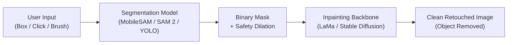
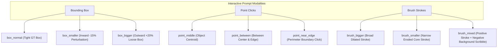
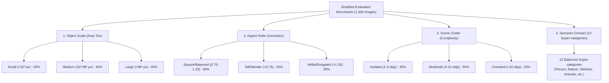
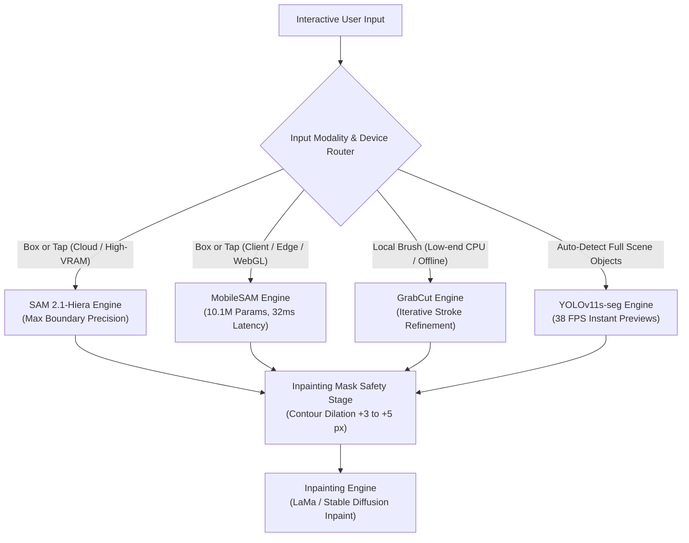

# 🎯 Interactive Object Segmentation Benchmark for Smart Image Retouching
### *Comprehensive Empirical Evaluation of Classical, Foundation, and Detection Models for Object Removal & Inpainting Pipelines*

---

## 📌 Overview & Objective

This module constitutes the **benchmarking, model selection, and empirical validation core** of the **Retouche Image Intelligente** (Smart Photo Retouching & Object Removal) system. 

In modern photo editing applications, interactive object removal follows a critical two-stage pipeline:
1. **Interactive Segmentation**: The user provides a lightweight visual cue (drawing a bounding box, tapping a click, or brushing across an unwanted object/person/blemish). The segmentation model must instantaneously extract an exact binary mask of the target.
2. **Generative Inpainting**: An inpainting backbone (e.g., Stable Diffusion, LaMa, or Fourier Inpainting) reconstructs the masked region using surrounding contextual pixels.



> [!IMPORTANT]
> **Why Segmentation Precision Dictates Inpainting Quality**:
> Inpainting algorithms cannot distinguish between intended targets and unintentional mask errors.
> - **Under-segmentation (High False Negative Rate - FNR)** leaves remnant edges or fragments of the unwanted object, causing the inpainter to produce grotesque **"ghost artifacts"**.
> - **Over-segmentation (High False Positive Rate - FPR)** destroys clean background context, forcing the inpainter to hallucinate large areas needlessly.
> - **Boundary Precision (Boundary IoU)** determines whether the inpainting seam blends seamlessly or creates conspicuous boundary halos.

This directory houses the complete 3-stage pipeline that empirically evaluates **9 segmentation models** across **9 interaction prompt variants** and **10 performance metrics** on **1,000 stratified, real-world LVIS images**, totaling **81,000 rigorous experimental evaluations**.

---

## 📂 Directory Architecture & File Inventory

```
benchmarking/
│
├── 1. stratified_sample_collection.ipynb   # Stage 1: LVIS data engineering, 4D stratification & Parquet export
├── 2. benchmark_evaluation.ipynb           # Stage 2: Dual-GPU high-throughput benchmark execution engine
├── 3. benchmark_result_analysis.ipynb      # Stage 3: Interactive statistical analysis, dashboard & export
├── dataset_benchmark_results.csv           # 81,000-row benchmark evaluation dataset (28 columns, 22.4 MB)
├── README.md                               # Comprehensive documentation of the benchmarking module
│
└── charts/                                 # Exported visual assets (Retina 300 DPI & standalone HTML)
    ├── 01_overall_leaderboard.png          # Global mIoU & latency rankings
    ├── 02_multimetric_radar.png            # Multi-dimensional trade-off radar chart
    ├── 03_miou_distribution_box.png        # Performance dispersion & outlier analysis
    ├── 04_modality_comparison.png          # Box vs Point vs Brush breakdown
    ├── 05_prompt_noise_sensitivity.png     # User error & perturbation robustness
    ├── 06_object_scale_area_impact.png     # Small vs Medium vs Large object analysis
    ├── 07_aspect_ratio_and_clutter_heatmaps.png # Aspect ratio & scene clutter performance
    ├── 08_supercategory_performance.png    # Semantic category domain transfer
    ├── 09_pareto_efficiency_frontier.png   # Latency vs Accuracy Pareto frontiers
    ├── 10_hardware_resource_profiles.png   # Parameter count & VRAM footprints
    ├── 11_fnr_vs_fpr_error_zones.png       # Inpainting risk quadrant analysis
    ├── 12_executive_unified_dashboard.png  # Consolidated multi-panel executive dashboard
    └── executive_dashboard.html             # Standalone, interactive HTML control dashboard
```

### Detailed Asset Catalog

| File / Directory | Type / Size | Primary Responsibility | Key Inputs / Outputs |
| :--- | :--- | :--- | :--- |
| [1. stratified_sample_collection.ipynb](file:///d:/9raya/IID3/Computer%20Vision/retouche_image_intelligente/ml/segmentation/benchmarking/1.%20stratified_sample_collection.ipynb) | Jupyter Notebook<br/>`~940 KB` | Extracts, cleans, balances, and packages 1,000 representative images from LVIS v1.0 across 4 stratification axes. | **In:** LVIS annotations<br/>**Out:** `lvis_stratified_dataset_1000.parquet` with embedded image bytes |
| [2. benchmark_evaluation.ipynb](file:///d:/9raya/IID3/Computer%20Vision/retouche_image_intelligente/ml/segmentation/benchmarking/2.%20benchmark_evaluation.ipynb) | Jupyter Notebook<br/>`~67 KB` | High-throughput evaluation harness optimized for Kaggle Dual GPU (T4 x2) or local CUDA workstations with atomic per-image checkpointing. | **In:** Stratified Parquet dataset<br/>**Out:** `dataset_benchmark_results.csv` (81,000 rows) |
| [3. benchmark_result_analysis.ipynb](file:///d:/9raya/IID3/Computer%20Vision/retouche_image_intelligente/ml/segmentation/benchmarking/3.%20benchmark_result_analysis.ipynb) | Jupyter Notebook<br/>`~877 KB` | 8-section interactive analytical suite featuring Plotly visualizations, Pareto efficiency frontiers, inpainting risk matrices, and executive dashboard. | **In:** `dataset_benchmark_results.csv`<br/>**Out:** 12 PNG charts + `executive_dashboard.html` |
| [dataset_benchmark_results.csv](file:///d:/9raya/IID3/Computer%20Vision/retouche_image_intelligente/ml/segmentation/benchmarking/dataset_benchmark_results.csv) | CSV Dataset<br/>`22.36 MB` | Exhaustive tabular record of all 81,000 evaluations across 28 feature, metadata, and metric columns. | Master experimental record for all downstream statistical evaluations. |
| [charts/](file:///d:/9raya/IID3/Computer%20Vision/retouche_image_intelligente/ml/segmentation/benchmarking/charts/) | Directory<br/>`~3.2 MB` | High-resolution publication-quality PNG charts (300 DPI equivalent) and self-contained interactive web dashboards. | Readily embeddable in reports, slides, and web interfaces. |

---

## 🔬 Benchmarking Methodology

### 1. Evaluated Models (9 Architectures)

To establish an authoritative comparison, 9 models spanning three distinct paradigms were evaluated:

| Family | Model | Type / Backing | Parameters | Primary Target Scenario |
| :--- | :--- | :--- | :--- | :--- |
| **Foundation** | **SAM 2** (`sam2.1-hiera-tiny`) | Hierarchical Vision Transformer (Hiera) | 38.9 M | Server-side high-precision interactive segmentation |
| **Foundation** | **MobileSAM** (`mobile_sam.pt`) | Lightweight ViT (TinyViT-5M encoder) | 10.1 M | On-device, edge, and browser client segmentation |
| **Real-time CNN** | **yolo11n-seg** | Ultralytics Nano Segmentation CNN | 2.9 M | Ultra-fast automated bounding box proposals |
| **Real-time CNN** | **yolo11s-seg** | Ultralytics Small Segmentation CNN | 10.1 M | Balanced real-time object detection & segmentation |
| **Real-time CNN** | **yolo11m-seg** | Ultralytics Medium Segmentation CNN | 22.4 M | Medium-capacity object proposal segmentation |
| **Real-time CNN** | **yolo11l-seg** | Ultralytics Large Segmentation CNN | 44.4 M | High-capacity object proposal segmentation |
| **Real-time CNN** | **yolo11x-seg** | Ultralytics Extra-Large Segmentation CNN | 62.1 M | Maximum capacity object proposal segmentation |
| **Classical** | **GrabCut** | Gaussian Mixture Models (GMM) + Graph Cut | 0.0 M | CPU baseline for iterative energy minimization |
| **Classical** | **Otsu** | Adaptive Global Bimodal Thresholding | 0.0 M | Minimalist baseline for luminance-based isolation |

### 2. Interaction Prompt Modalities & Noise Variants (9 Variants)

Real-world users do not provide mathematically perfect prompts. The benchmark evaluates 3 modalities, each subjected to realistic user error perturbations:



- **Bounding Box Variants**:
  - `box_normal`: Tight bounding box enclosing the ground-truth mask $[x_1, y_1, x_2, y_2]$.
  - `box_smaller`: Shrunk inward by 10–15% (simulating clipped or hasty user selection).
  - `box_bigger`: Expanded outward by 10–20% (simulating generous or loose user selection).
- **Point Click Variants**:
  - `point_middle`: Single positive click at the object mask centroid.
  - `point_between`: Positive click halfway between centroid and contour boundary.
  - `point_near_edge`: Challenging click located within 10% distance of the contour boundary.
- **Brush Stroke Variants**:
  - `brush_bigger`: Simulated broad brush stroke covering the object interior with outer edge dilation.
  - `brush_smaller`: Simulated thin brush stroke tracing the morphological skeleton of the object.
  - `brush_mixed`: Dual stroke combining an interior foreground scribble with an exterior background exclusion cue.

### 3. Multi-Dimensional Evaluation Metrics (10 Metrics)

The benchmark captures both segmentation fidelity and system efficiency:

1. **Mean Intersection over Union ($\text{mIoU}$)**:
   $$\text{IoU} = \frac{|P \cap GT|}{|P \cup GT|}$$
2. **Dice Similarity Coefficient ($\text{F1}$)**:
   $$\text{Dice} = \frac{2 |P \cap GT|}{|P| + |GT|}$$
3. **Boundary IoU**: Mask contour overlap within an edge radius distance $d$ (evaluates seam quality for inpainting).
4. **False Negative Rate ($\text{FNR}$)**: Under-segmentation ratio $\frac{|GT \setminus P|}{|GT|}$ (quantifies residual ghost artifact risk).
5. **False Positive Rate ($\text{FPR}$)**: Over-segmentation ratio $\frac{|P \setminus GT|}{|I \setminus GT|}$ (quantifies unnecessary background destruction).
6. **Prompt Latency ($\text{ms}$)**: Time required to decode a prompt and predict the mask once the image is embedded.
7. **Encoder Latency ($\text{ms}$)**: Heavy one-time backbone forward pass latency to compute the image feature embedding.
8. **Throughput ($\text{FPS}$)**: End-to-end processing frame rate ($\frac{1000}{\text{Encoder Latency} + \text{Prompt Latency}}$).
9. **Peak VRAM Allocation ($\text{MB}$)**: Maximum GPU memory consumed during inference.
10. **Parameter Count ($\text{M}$)**: Total model parameter footprint in millions of weights.

---

## 📊 Dataset Stratification Architecture

A benchmark is only as reliable as the distribution of its test images. Random sampling introduces severe bias toward large objects and frequent classes (e.g., chairs, people). 

In [1. stratified_sample_collection.ipynb](file:///d:/9raya/IID3/Computer%20Vision/retouche_image_intelligente/ml/segmentation/benchmarking/1.%20stratified_sample_collection.ipynb), a multi-objective dynamic stratification engine samples **1,000 unique images** (exactly 1 target object instance per image) balanced across **4 fundamental dimensions**:



### Self-Contained Parquet Packaging
To eliminate network latency, broken URLs, and external dependencies during evaluation, images are downloaded asynchronously using `ThreadPoolExecutor`, converted to high-quality compressed image bytes, and stored alongside their polygon annotations in an Apache Parquet container (`lvis_stratified_dataset_1000.parquet`).

---

## ⚡ High-Throughput & Fault-Tolerant Dual-GPU Execution

[2. benchmark_evaluation.ipynb](file:///d:/9raya/IID3/Computer%20Vision/retouche_image_intelligente/ml/segmentation/benchmarking/2.%20benchmark_evaluation.ipynb) is engineered for continuous multi-hour execution on dual-accelerator environments (e.g., Kaggle Dual T4 x2 or multi-GPU local workstations).

### 1. Hardware Allocation & Parallel Worker Architecture
- **GPU 0 (`cuda:0`)**: Hosts Vision Transformer models (`SAM 2.1-hiera-tiny` and `MobileSAM`). Heavy image embeddings are computed once per image; then, prompt decoding executes rapidly.
- **GPU 1 (`cuda:1`)**: Hosts the 5 real-time CNN detectors (`yolo11n/s/m/l/x-seg`).
- **CPU**: Executes classical baselines (`GrabCut` and `Otsu`).
- **Asynchronous Orchestration**: A `ThreadPoolExecutor` parallelizes GPU 0, GPU 1, and CPU workloads simultaneously for every image, yielding near **3× throughput acceleration**.

### 2. Resilient Atomic Checkpointing
Evaluating 81,000 predictions takes several hours. To ensure 100% fault tolerance against kernel crashes, out-of-memory (OOM) errors, or Kaggle session timeouts:
1. Results are appended atomically to `dataset_benchmark_results.csv` after every completed image.
2. An immediate `f.flush()` and `os.fsync(f.fileno())` forces OS buffers to physical disk.
3. State progress is tracked in `dataset_benchmark_checkpoint.json`.
4. **Instant Resumption**: If interrupted at image #441, re-running the notebook seamlessly verifies completed rows and resumes from image #442 without duplicate evaluations or data loss.

---

## 🏆 Key Experimental Findings & Leaderboard

The benchmark evaluated **81,000 distinct inferences**. Below is the global performance leaderboard:

| Model | Architecture | Mean mIoU | Dice F1 | Boundary IoU | FNR (Under-seg) | FPR (Over-seg) | Prompt Latency | Encoder Latency | FPS | VRAM | Params |
| :--- | :--- | :---: | :---: | :---: | :---: | :---: | :---: | :---: | :---: | :---: | :---: |
| 🥇 **SAM 2** | Foundation ViT | **0.6614** | **0.7353** | **0.1974** | **18.7%** | **0.98%** | 30.5 ms | 299.9 ms | 4.73 | 724 MB | 38.9 M |
| 🥈 **MobileSAM** | Tiny ViT | **0.6366** | **0.7107** | **0.1871** | 20.4% | 1.12% | **32.5 ms** | **85.0 ms** | 8.52 | 575 MB | **10.1 M** |
| 🥉 **yolo11x-seg** | CNN (Extra Large)| 0.5196 | 0.5891 | 0.0793 | 36.1% | 3.45% | 104.6 ms | 0.0 ms | 10.23 | 680 MB | 62.1 M |
| 4. **yolo11m-seg** | CNN (Medium) | 0.5069 | 0.5790 | 0.0743 | 37.4% | 3.61% | 44.3 ms | 0.0 ms | 24.14 | 490 MB | 22.4 M |
| 5. **yolo11l-seg** | CNN (Large) | 0.5065 | 0.5786 | 0.0758 | 37.5% | 3.58% | 53.9 ms | 0.0 ms | 19.59 | 550 MB | 44.4 M |
| 6. **yolo11s-seg** | CNN (Small) | 0.4865 | 0.5592 | 0.0682 | 39.8% | 3.92% | 30.8 ms | 0.0 ms | 38.79 | 360 MB | 10.1 M |
| 7. **GrabCut** | Classical GMM | 0.4708 | 0.5367 | 0.1159 | 43.2% | 5.12% | 700.5 ms | 0.0 ms | 111.73 | 0 MB | 0.0 M |
| 8. **yolo11n-seg** | CNN (Nano) | 0.4531 | 0.5248 | 0.0608 | 43.1% | 4.21% | 32.8 ms | 0.0 ms | **41.06** | **210 MB** | **2.9 M** |
| 9. **Otsu** | Luminance Thresh| 0.3822 | 0.4421 | 0.0740 | 52.8% | 9.87% | **0.4 ms** | 0.0 ms | 4156.9 | 0 MB | 0.0 M |

### 💡 Core Strategic Insights

1. **SAM 2 is the Precision Champion**:
   - Outperforms all models in mIoU ($0.6614$), Dice ($0.7353$), and Boundary IoU ($0.1974$).
   - Lowest False Positive Rate ($0.98\%$), meaning it almost never destroys adjacent background pixels.
2. **MobileSAM is the Efficiency & Edge Winner**:
   - Retains **$96.2\%$ of SAM 2's accuracy** ($0.6366$ vs $0.6614$ mIoU) with only **$26\%$ of the parameter footprint** ($10.1\text{ M}$ vs $38.9\text{ M}$).
   - Encoder latency is $3.5\times$ faster ($85\text{ ms}$ vs $300\text{ ms}$), enabling smooth interactive client-side execution.
3. **The "Small Object Catastrophe" in YOLO Models**:
   - On large COCO objects, YOLO models achieve $>0.71\text{ mIoU}$.
   - However, on small objects ($<32^2\text{ px}$), **YOLO collapses completely** ($0.136\text{ mIoU}$ for Nano, $0.217\text{ mIoU}$ for Extra-Large). Because YOLO operates as a closed-vocabulary object detector, it fails to generate proposals for uncommon or non-COCO categories.
4. **Prompt Modality Dynamics**:
   - **Bounding Box** is the most reliable prompt for Foundation models: SAM 2 achieves **$0.8008\text{ mIoU}$** on boxes (up to $0.8401$ on normal boxes) and is exceptionally robust to loose boxes (`box_bigger`).
   - **Point Clicks** suffer from semantic ambiguity, dropping SAM 2 to $0.570\text{ mIoU}$.
   - **Brush Strokes** favor GrabCut ($0.689\text{ mIoU}$), whereas GrabCut collapses on single point clicks ($0.248\text{ mIoU}$).

---

## 🏗️ Production Recommendations for Smart Image Retouching

Based on our empirical findings, we recommend a **Multi-Model Hybrid Architecture** for the interactive inpainting application:



### Inpainting Mask Safety Rules
- **Contour Dilation**: Due to the severe ghosting penalty of under-segmentation ($\text{FNR}$), all predicted masks should undergo morphological dilation ($+3$ to $+5$ pixels) before being sent to the inpainter.
- **Point Click Ambiguity**: When the user taps a single point, the UI should invoke SAM 2's multimask mode, rendering 3 candidate masks (sub-part, part, whole object) for one-click user selection.

---

## 📈 Visual Asset & Dashboard Inventory

All 12 analysis charts and the interactive dashboard are stored in [charts/](file:///d:/9raya/IID3/Computer%20Vision/retouche_image_intelligente/ml/segmentation/benchmarking/charts/):

| Asset File | Visual Description | Key Insight Revealed |
| :--- | :--- | :--- |
| [01_overall_leaderboard.png](file:///d:/9raya/IID3/Computer%20Vision/retouche_image_intelligente/ml/segmentation/benchmarking/charts/01_overall_leaderboard.png) | Horizontal bar chart of mean mIoU with latency badges. | SAM 2 and MobileSAM decisively outperform all YOLO and classical baselines. |
| [02_multimetric_radar.png](file:///d:/9raya/IID3/Computer%20Vision/retouche_image_intelligente/ml/segmentation/benchmarking/charts/02_multimetric_radar.png) | 6-axis radar comparison (mIoU, Dice, Boundary IoU, 1-FNR, 1-FPR, FPS). | Illustrates the comprehensive dominance of Foundation models across geometric metrics. |
| [03_miou_distribution_box.png](file:///d:/9raya/IID3/Computer%20Vision/retouche_image_intelligente/ml/segmentation/benchmarking/charts/03_miou_distribution_box.png) | Box-and-whisker plot displaying performance variance across 1,000 images. | Highlights YOLO's heavy concentration of zero-IoU outliers on non-COCO objects. |
| [04_modality_comparison.png](file:///d:/9raya/IID3/Computer%20Vision/retouche_image_intelligente/ml/segmentation/benchmarking/charts/04_modality_comparison.png) | Grouped bar chart comparing Box, Point, and Brush performance. | Proves that Bounding Box is the superior interaction modality for foundation models. |
| [05_prompt_noise_sensitivity.png](file:///d:/9raya/IID3/Computer%20Vision/retouche_image_intelligente/ml/segmentation/benchmarking/charts/05_prompt_noise_sensitivity.png) | Delta variance plot under user perturbation (loose box, near-edge point). | Demonstrates SAM 2's resilience to oversized bounding boxes. |
| [06_object_scale_area_impact.png](file:///d:/9raya/IID3/Computer%20Vision/retouche_image_intelligente/ml/segmentation/benchmarking/charts/06_object_scale_area_impact.png) | Grouped analysis across Small ($<32^2$), Medium ($32^2-96^2$), and Large ($>96^2$) objects. | Exposes the small object failure mode in YOLO models. |
| [07_aspect_ratio_and_clutter_heatmaps.png](file:///d:/9raya/IID3/Computer%20Vision/retouche_image_intelligente/ml/segmentation/benchmarking/charts/07_aspect_ratio_and_clutter_heatmaps.png) | Dual heatmaps cross-referencing aspect ratio and scene clutter tiers. | Validates foundation model stability across crowded visual scenes. |
| [08_supercategory_performance.png](file:///d:/9raya/IID3/Computer%20Vision/retouche_image_intelligente/ml/segmentation/benchmarking/charts/08_supercategory_performance.png) | Matrix heatmap across 12 semantic super-categories. | Shows open-world zero-shot generalization of SAM vs closed-vocabulary YOLO. |
| [09_pareto_efficiency_frontier.png](file:///d:/9raya/IID3/Computer%20Vision/retouche_image_intelligente/ml/segmentation/benchmarking/charts/09_pareto_efficiency_frontier.png) | Interactive Pareto frontier plot (Latency vs mIoU). | Identifies MobileSAM and SAM 2 on the optimal efficiency frontier. |
| [10_hardware_resource_profiles.png](file:///d:/9raya/IID3/Computer%20Vision/retouche_image_intelligente/ml/segmentation/benchmarking/charts/10_hardware_resource_profiles.png) | Dual-axis parameter count (M) and peak VRAM allocation (MB). | MobileSAM delivers maximum parameter efficiency ($10.1\text{ M}$ params). |
| [11_fnr_vs_fpr_error_zones.png](file:///d:/9raya/IID3/Computer%20Vision/retouche_image_intelligente/ml/segmentation/benchmarking/charts/11_fnr_vs_fpr_error_zones.png) | Scatter plot mapping models across Inpainting Risk quadrants. | Positions SAM 2 in the coveted "Low Ghosting, Low Context Damage" sweet spot. |
| [12_executive_unified_dashboard.png](file:///d:/9raya/IID3/Computer%20Vision/retouche_image_intelligente/ml/segmentation/benchmarking/charts/12_executive_unified_dashboard.png) | Multi-panel unified executive dashboard. | Complete 4-quadrant overview of KPIs, leaderboards, trade-offs, and risk. |
| [executive_dashboard.html](file:///d:/9raya/IID3/Computer%20Vision/retouche_image_intelligente/ml/segmentation/benchmarking/charts/executive_dashboard.html) | Standalone interactive HTML web dashboard. | Interactive filtering, tooltips, and zoomable control center for presentations. |

---

## 🚀 Reproduction & Quickstart Guide

### Prerequisites
Install the required computer vision, deep learning, and analytical dependencies:
```bash
pip install torch torchvision torchaudio --index-url https://download.pytorch.org/whl/cu121
pip install ultralytics segment-anything-2 timm opencv-python-headless pillow pandas pyarrow plotly kaleido
```

### Step 1: Collect & Stratify Dataset
Run [1. stratified_sample_collection.ipynb](file:///d:/9raya/IID3/Computer%20Vision/retouche_image_intelligente/ml/segmentation/benchmarking/1.%20stratified_sample_collection.ipynb) to generate the balanced 1,000-image dataset:
- Filters LVIS annotations.
- Balances across Scale, Aspect Ratio, Clutter, and Categories.
- Exports self-contained `lvis_stratified_dataset_1000.parquet`.

### Step 2: Execute the Benchmark
Run [2. benchmark_evaluation.ipynb](file:///d:/9raya/IID3/Computer%20Vision/retouche_image_intelligente/ml/segmentation/benchmarking/2.%20benchmark_evaluation.ipynb) (locally or on Kaggle Dual T4 x2):
- Loads models onto `cuda:0`, `cuda:1`, and CPU.
- Automatically creates and updates `dataset_benchmark_results.csv`.
- Resumes seamlessly if interrupted.

### Step 3: Analyze Results & Export Dashboards
Run [3. benchmark_result_analysis.ipynb](file:///d:/9raya/IID3/Computer%20Vision/retouche_image_intelligente/ml/segmentation/benchmarking/3.%20benchmark_result_analysis.ipynb):
- Computes comprehensive statistical summaries.
- Generates interactive Plotly figures.
- Exports all 12 charts and `executive_dashboard.html` to [charts/](file:///d:/9raya/IID3/Computer%20Vision/retouche_image_intelligente/ml/segmentation/benchmarking/charts/).
